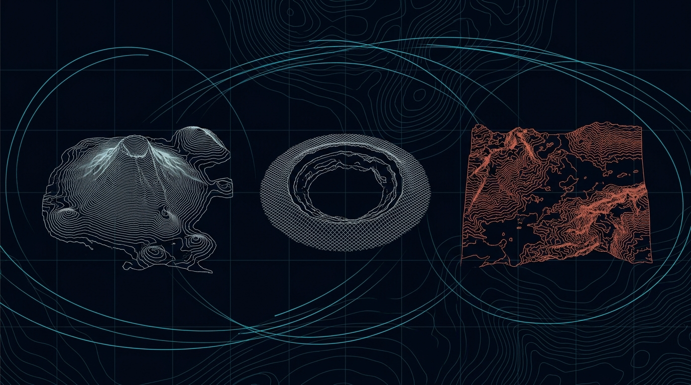
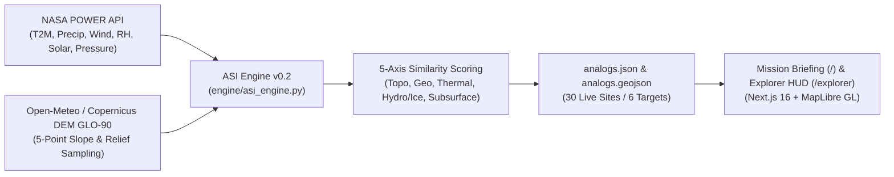

<p align="center">
  
</p>

<h1 align="center">TERR-ANALOG // NASA Space Apps Challenge 2026</h1>

<p align="center">
  Planetary analog discovery and Analog Similarity Index (ASI) telemetry platform for <strong>Identify Earth Locations that Analog the Permanent Moon Base Locations and Mars</strong>.
</p>

<p align="center">
  <a href="https://github.com/FakeCxbas/nasa-space-apps-2026/actions/workflows/ci.yml">
    
  </a>
  
  
  
</p>

---

## System Architecture



## Extraterrestrial Reference Targets

| Target ID | Reference Site | Body | Primary Mission Context |
| :--- | :--- | :--- | :--- |
| `shackleton-crater` | Shackleton Crater / Lunar South Pole | Moon | Artemis polar cold-trap & volatile ice prospecting |
| `mare-tranquillitatis` | Mare Tranquillitatis Pits | Moon | Subsurface basaltic lava tube thermal shielding |
| `mouton-mons` | Mons Mouton / Lunar South Pole Plateau | Moon | Artemis III high-illumination plateau & polar regolith |
| `jezero-crater` | Jezero Crater | Mars | Fluvio-lacustrine delta, clays, carbonates & basalt |
| `olympus-mons-flank` | Olympus Mons Flank | Mars | High-elevation volcanic shield & lava tube operations |
| `valles-marineris` | Valles Marineris | Mars | Deep tectonic canyon stratigraphy, sulfates & talus slopes |

> [!NOTE]
> Every analog evaluation explicitly reports both **where the analogy holds** and **where it breaks down** (Earth gravity `9.81 m/s²` vs `1.62` / `3.71 m/s²`, vacuum/thin CO2 atmosphere, ionizing radiation, and terrestrial biological weathering).

---

## Quickstart

### 1. Frontend (Next.js 16 + MapLibre GL)
```bash
cd frontend
npm install
npm run dev
```
- `http://localhost:3000/` — **TERR-ANALOG — Mission Briefing** (interactive scientific presentation, comparative Earth vs. Moon/Mars panels, live ASI breakdown, and planetary destination catalog).
- `http://localhost:3000/explorer` — **Geospatial Explorer HUD** (interactive 3D terrain map, live coordinate probing `/api/evaluate`, regional grid prospecting `/api/evaluate-region`, side-by-side comparison, and Markdown/JSON/GeoJSON export). Supports deep-linking via `?target=<id>` and `?site=<id>`.

### 2. Scientific ASI Engine (Python / uv)
```bash
cd engine
uv sync
.venv/bin/python -m pytest tests
.venv/bin/python build_dataset.py --timeout 10
```

---

## Active Frontend Issues & Progress

| Issue | Scope | Status |
| :--- | :--- | :--- |
| [#2](https://github.com/FakeCxbas/nasa-space-apps-2026/issues/2) | `feat(ui)`: Side-by-side Earth vs Moon/Mars target comparison view | Open |
| [#3](https://github.com/FakeCxbas/nasa-space-apps-2026/issues/3) | `feat(map)`: 3D terrain tilt, site telemetry popups & NASA GIBS controls | Open |
| [#4](https://github.com/FakeCxbas/nasa-space-apps-2026/issues/4) | `feat(ux)`: ASI dossier export, methodology dialog & mobile HUD | Closed ([PR #8](https://github.com/FakeCxbas/nasa-space-apps-2026/pull/8)) |
| [#6](https://github.com/FakeCxbas/nasa-space-apps-2026/issues/6) | `feat(engine)`: Copernicus DEM sampling, NASA POWER v0.2 & 16 sites | Closed ([PR #7](https://github.com/FakeCxbas/nasa-space-apps-2026/pull/7)) |

---

## Team Git Workflow

1. Never push directly to the default branch. Create a dedicated branch:
   ```bash
   git checkout -b feat/issue-2-target-comparison
   ```
2. Use Conventional Commits (`feat(...)`, `fix(...)`, `docs(...)`, `test(...)`) and link the issue:
   ```bash
   git commit -m "feat(ui): add side-by-side target comparison view (closes #2)"
   ```
3. Push and open a Pull Request:
   ```bash
   git push -u origin feat/issue-2-target-comparison
   gh pr create --fill
   ```
