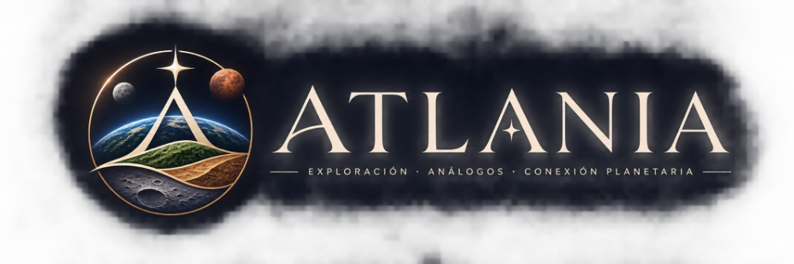
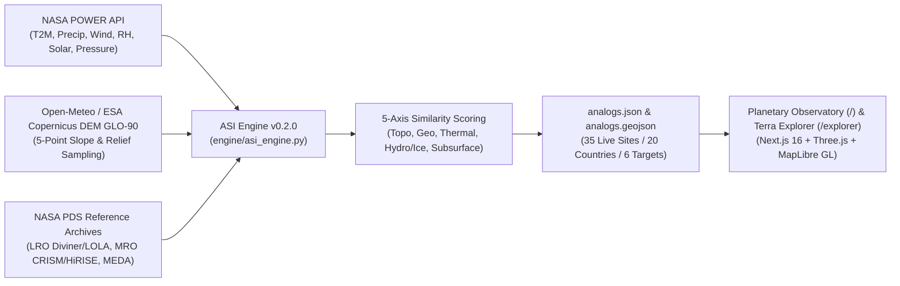

<p align="center">
  
</p>

<h1 align="center">ATLANIA // Planetary Observatory &amp; Earth-Space Analog Atlas</h1>

<p align="center">
  <strong>NASA International Space Apps Challenge 2026</strong><br />
  Challenge: <em>Identify Earth Locations that Analog the Permanent Moon Base Locations and Mars</em>
</p>

<blockquote align="center">
  <em>
    &ldquo;There is a particular beauty in the places we have yet to find.<br />
    Centuries ago, cartographers drew territories they had not yet explored. Today we look up at the sky and recognize craters, canyons, and plains that seem to belong to entirely different worlds.<br /><br />
    <strong>What if, in order to understand other planets, we first had to rediscover our own?</strong><br /><br />
    ATLANIA is born from that question. It does not seek to invent lost territories; it seeks to reveal the extraordinary landscapes that already exist on Earth to open a window toward the Moon and Mars.<br />
    Because perhaps the unknown was always here, waiting for us to look again.&rdquo;
  </em>
</blockquote>

<details>
<summary align="center"><strong>Leer Manifiesto en Español</strong></summary>
<blockquote align="center">
  <em>
    &ldquo;Existe una belleza particular en los lugares que no podemos encontrar.<br />
    Hace siglos, los cartógrafos dibujaban territorios que todavía no habían explorado. Hoy levantamos la mirada al cielo y reconocemos cráteres, cañones y llanuras que parecen pertenecer a mundos completamente distintos.<br /><br />
    <strong>¿Y si para comprender otros planetas primero tuviéramos que volver a descubrir el nuestro?</strong><br /><br />
    ATLANIA nace de esa pregunta. No busca inventar territorios perdidos; busca revelar lo extraordinario que ya existe en la Tierra para abrir una ventana hacia la Luna y Marte.<br />
    Porque quizá lo desconocido siempre estuvo aquí, esperando a que volviéramos a mirar.&rdquo;
  </em>
</blockquote>
</details>

<p align="center">
  <a href="https://github.com/FakeCxbas/Atlania/actions/workflows/ci.yml">
    
  </a>
  
  
  
  
  
  <a href="LICENSE">
    
  </a>
</p>

<p align="center">
  <a href="docs/NASA_SUBMISSION_2026.md"><strong>Official NASA Space Apps 2026 Submission Kit (English)</strong></a> ·
  <a href="engine/README.md"><strong>Scientific ASI Engine Documentation</strong></a> ·
  <a href="frontend/public/nasa/SOURCES.md"><strong>NASA &amp; ESA Media Attribution</strong></a>
</p>

---

## Overview

Before deploying pressurized habitats, cryogenic In-Situ Resource Utilization (ISRU) drills, or autonomous rovers to the Lunar South Pole (*Artemis*) and Martian basins (*Perseverance / Mars Sample Return*), space agencies must validate hardware, traverse algorithms, and human operations in terrestrial environments that reproduce key planetary constraints.

**ATLANIA** (*Celestial Earth*) is an open-source planetary observatory and quantitative geospatial atlas that evaluates **35 terrestrial analog sites across 20 countries** (including 8 high-altitude volcanic and basaltic lava tube sites in Ecuador) against **6 Lunar and Martian reference environments** using live satellite telemetry, 3D topographic twin modeling, and our 5-axis **Analog Similarity Index (ASI v0.2.0)**.

---

## System Architecture



---

## Extraterrestrial Reference Targets (NASA PDS Calibrated)

| Target ID | Reference Site | Body | Primary Mission Context | Mission Weights `(Topo, Geo, Therm, Hydro, Sub)` |
| :--- | :--- | :--- | :--- | :--- |
| `shackleton-crater` | Shackleton Crater / Lunar South Pole | Moon | Artemis polar cold-trap (`-183 °C`) & volatile water-ice prospecting | `(0.25, 0.20, 0.20, 0.30, 0.05)` |
| `mare-tranquillitatis` | Mare Tranquillitatis Skylight Pits | Moon | Subsurface basaltic lava tube thermal shielding (`~17 °C` shaded pit) | `(0.15, 0.30, 0.15, 0.10, 0.30)` |
| `mouton-mons` | Mons Mouton / Lunar South Pole Plateau | Moon | Artemis III high-illumination flat-topped plateau & polar regolith | `(0.30, 0.25, 0.20, 0.20, 0.05)` |
| `jezero-crater` | Jezero Crater | Mars | Fluvio-lacustrine delta, phyllosilicate clays, carbonates & basalt | `(0.20, 0.35, 0.15, 0.25, 0.05)` |
| `olympus-mons-flank` | Olympus Mons Flank | Mars | High-elevation basaltic shield volcanism & collapsed lava tubes | `(0.25, 0.30, 0.15, 0.10, 0.20)` |
| `valles-marineris` | Valles Marineris / Coprates Chasma | Mars | Deep tectonic canyon stratigraphy, polyhydrated sulfates & steep talus | `(0.35, 0.30, 0.10, 0.20, 0.05)` |

---

## Scientific Evaluation Methodology (ASI v0.2.0)

The **Analog Similarity Index (ASI)** computes an auditable, mission-weighted quantitative correlation ($0$ to $100$) normalized across five physical dimensions using bounded linear similarity $L(a, b; s) = \max(0, 1 - |a - b| / s)$:

1. **Topography & Relief:** $0.5\,L(\text{slope}_E, \text{slope}_T; 30^\circ) + 0.5\,L(\text{roughness}_E, \text{roughness}_T; 1)$, backed by 5-point central finite-difference sampling ($\pm 0.01^\circ$ stencil) on the **ESA Copernicus DEM GLO-90** (90 m resolution).
2. **Geology & Mineralogy:** Fuzzy Jaccard overlap $\sum_i \min(E_i, T_i) / \sum_i \max(E_i, T_i)$ across five lithological memberships: basalt, regolith, sedimentary/clays, evaporites/sulfates, and impact cratering relevance.
3. **Extreme Thermal Regime:** $0.6\,L(\text{mean}_E, \text{mean}_T; 100^\circ\text{C}) + 0.4\,L(\text{range}_E, \text{range}_T; 100^\circ\text{C})$, derived from **NASA POWER** 2-meter air temperature climatology (`T2M_MAX`, `T2M_MIN`).
4. **Hydrology, Aridity & Cryosphere:** $0.4\,L(\text{dryness}_E, \text{dryness}_T; 1) + 0.4\,L(\text{ice}_E, \text{ice}_T; 1) + 0.2\,L(\text{aqueous}_E, \text{aqueous}_T; 1)$, where terrestrial dryness is $1 / (1 + P_{\text{mm/day}})$ from **NASA POWER** (`PRECTOTCORR`). Live custom coordinate probes incorporate relative humidity (`RH2M`) and biosphere penalties to filter out vegetated orographic noise.
5. **Subsurface & Habitat Operations:** $0.7\,L(\text{lava\_tubes}_E, \text{lava\_tubes}_T; 1) + 0.3\,L(\text{shelter}_E, \text{shelter}_T; 1)$, evaluating basaltic lava tube skylights and natural ionizing-radiation shielding for Artemis and Mars habitats.

### Key Regional & Global Analog Highlights (35 Sites / 20 Countries)

- **Galápagos Lava Tubes & Sierra Negra (Ecuador):** Pristine basaltic lava conduits on Santa Cruz and Isabela islands with stable subsurface temperatures ($\sim 22^\circ\text{C}$), serving as primary structural analogs for subterranean lunar habitats in *Mare Tranquillitatis*.
- **High-Altitude Andean Volcanic Corridor (Ecuador):** *Chimborazo* ($>4,800\text{ m}$ periglacial cryosphere), *Cotopaxi* (pyroclastic tephra plains), *Antisana*, *Sangay*, *El Reventador*, and *Quilotoa* (hydrothermal crater lake).
- **Atacama Hyperarid Core, Salar de Uyuni & Puna (Chile / Bolivia / Argentina / Peru):** *Atacama Yungay*, *Valle de la Luna*, *Salar de Uyuni*, *Laguna Colorada*, *Puna / Laguna Verde*, *Campo de Piedra Pómez*, *Cono de Arita*, and *Pampas de la Joya*.
- **Global Benchmarks & Under-Recognized Discoveries:** *Haughton Crater / Devon Island* (Canada), *McMurdo Dry Valleys* (Antarctica), *Craters of the Moon*, *Mauna Loa HI-SEAS*, *Barringer Crater*, & *Pisgah Crater* (USA), *Río Tinto* & *Timanfaya* (Spain), *Askja* (Iceland), *Svalbard Bockfjord* (Norway), *Dallol* & *Erta Ale* (Ethiopia), *Qaidam Basin* (China), *Lut Desert* (Iran), *Tibesti* (Chad), *Namib Sossusvlei* (Namibia), *Tolbachik* (Kamchatka), *Lonar Crater* (India), and *Pilbara Craton* (Australia).

---

## NASA Data & 2026 Space Agency Partner Resources

| Agency / Source | Dataset / Instrument | Role in ATLANIA |
| :--- | :--- | :--- |
| **NASA LaRC** | **NASA POWER Climatology API** (`T2M_MAX`, `T2M_MIN`, `PRECTOTCORR`, `WS10M`, `RH2M`, `ALLSKY_SFC_SW_DWN`, `PS`) | Live meteorological telemetry for all 35 catalog sites and real-time coordinate/region probing |
| **NASA Earthdata** | **NASA GIBS WMTS** (`MODIS_Terra_CorrectedReflectance_TrueColor`) | Interactive orbital imagery overlay with date & opacity controls in `/explorer` |
| **NASA PDS** | **LRO Diviner** (`LRO-L-DLRE-5-GCP-V1.0`), **LRO LOLA**, **LROC CDR** (`LRO-L-LROC-3-CDR-V1.0`) | Lunar thermal, slope, and skylight pit baselines (`shackleton-crater`, `mare-tranquillitatis`, `mouton-mons`) |
| **NASA PDS / JPL** | **Mars 2020 MEDA** (`DOI:10.17189/1522849`), **MRO CRISM**, **MRO HiRISE**, **MGS MOLA** | Martian environmental, mineralogical, and topographic baselines (`jezero-crater`, `olympus-mons-flank`, `valles-marineris`) |
| **NASA / USGS** | **Landsat 8 & 9 (OLI/OLI-2 & TIRS/TIRS-2)** | Multi-spectral optical (Bands 2–7) and thermal inertia (Bands 10–11) profiles in `satellite_observatory` |
| **ESA (Partner)** | **Copernicus DEM GLO-90** (`DOI:10.5270/ESA-c5d3d65` via Open-Meteo Elevation API) | 90 m 5-point gradient slope (`dem_slope_deg`) and roughness (`dem_roughness_m`) sampling |
| **ESA (Partner)** | **Copernicus Sentinel-1 C-Band SAR** & **ESA/NASA AMASE** | Centimeter-scale radar backscatter roughness profiles (`satellite_observatory.radar_sar`) & Arctic analog context |
| **CSA / AEE / ISRO** | **Devon Island (CSA)**, **Río Tinto & Timanfaya (AEE Spain)**, **Lonar Crater (ISRO India)** | Space Agency Partner regional analog sites and field testbed documentation |

---

## Quickstart & Verification

### 1. Frontend Web Application (Next.js 16 + Three.js + MapLibre GL)

Requires Node.js 22.6+:

```bash
cd frontend
npm ci
npm test          # Runs 50 unit & regression tests (dossier, region grid, 3D DEM mesh, planetary terrain)
npm run lint      # ESLint static verification
npm run dev       # Starts local server on http://localhost:3000
```

- `http://localhost:3000/` — **ATLANIA Planetary Observatory & Interactive Briefing**: 5-chapter 3D WebGL spatial narrative, interactive 4-stratum geological crust block, and live ASI dimension breakdown.
- `http://localhost:3000/explorer` — **ATLANIA Terra Explorer & 3D Satellite Observatory**: Interactive 3D globe, country/planet navigation, Three.js HD 3D topographic twin with solar shadow simulation, side-by-side Earth vs. Moon/Mars 3D surface comparison, live coordinate probing (`/api/evaluate`), orbital region grid scanning (`/api/evaluate-region`), and QGIS GeoJSON/Markdown/JSON dossier export.
- `http://localhost:3000/presentacion` — **Scientific Dossier & Executive Summary View**.

### 2. Scientific ASI Engine (Python 3.11+ / uv)

```bash
cd engine
uv sync
.venv/bin/python -m pytest tests                  # Runs 219 unit & property tests
.venv/bin/python build_dataset.py --timeout 10    # Fetches live NASA POWER + Copernicus DEM for all 35 sites
.venv/bin/python build_dataset.py --offline       # Deterministic offline build without network calls
```

---

## Super Intelligence (SI) Transparency & Attribution

In compliance with the **2026 NASA International Space Apps Challenge** rules on Super Intelligence (SI):

1. **Human-Led Scientific & Architectural Design:** The project concept, 5-axis Analog Similarity Index (ASI) mathematical equations, mission weight calibrations, selection of the 35 terrestrial sites and 6 Lunar/Martian targets, and physical breakdown criteria were designed and verified by the team.
2. **Code & Engineering Assistance:** Software development, React/Three.js component scaffolding, PNG `DecompressionStream` elevation decoding, and automated test suites (219 Python `pytest` tests and 50 Node.js tests) were accelerated using AI coding assistants (Google Gemini / Antigravity and OpenAI Codex CLI). All environmental data in `analogs.json` and `analogs.geojson` is fetched deterministically from official NASA POWER and Open-Meteo/Copernicus APIs.
3. **Visual Assets & NASA Branding Compliance:** No NASA logos, flags, or mission identifiers were generated or modified using SI tools. All planetary and satellite photographs in [`frontend/public/nasa/`](frontend/public/nasa/SOURCES.md) are authentic public-domain NASA/JPL/USGS/ESA assets. The custom ATLANIA cartographic emblem (`frontend/public/brand/`) was conceptualized with generative design assistance and refined by the team.
4. **Audio Synthesis:** Demonstration video narration tracks in `docs/audio/` were generated from human-written scripts using neural text-to-speech (`edge-tts` via `docs/audio/generate_voiceover.py`).

---

## Engineering Milestones & Traceability

| Issue / PR | Scope | Status |
| :--- | :--- | :--- |
| [#6](https://github.com/FakeCxbas/Atlania/issues/6) / [PR #7](https://github.com/FakeCxbas/Atlania/pull/7) | `feat(engine)`: Copernicus DEM 5-point sampling & NASA POWER v0.2 | Merged & Closed |
| [#14](https://github.com/FakeCxbas/Atlania/issues/14) / [PR #25](https://github.com/FakeCxbas/Atlania/pull/25) | `feat(region)`: Orbital grid-search scanner (`/api/evaluate-region`) & sector matrix | Merged & Closed |
| [#32](https://github.com/FakeCxbas/Atlania/issues/32) / [PR #49](https://github.com/FakeCxbas/Atlania/pull/49) | `feat(catalog)`: Expand catalog to 35 global sites, 6 targets & 3-sensor satellite profiles | Merged & Closed |
| [#54](https://github.com/FakeCxbas/Atlania/issues/54) / [PR #59](https://github.com/FakeCxbas/Atlania/pull/59) | `feat(3d)`: Three.js HD 3D topographic twin, solar simulation & Earth vs. Moon/Mars 3D comparison | Merged & Closed |
| [#67](https://github.com/FakeCxbas/Atlania/issues/67) / [PR #68](https://github.com/FakeCxbas/Atlania/pull/68) | `feat(explorer)`: Minimalist cartographic layout & 6-block telemetry panel | Merged & Closed |
| [#61](https://github.com/FakeCxbas/Atlania/issues/61) / [PR #76](https://github.com/FakeCxbas/Atlania/pull/76) | `feat(landing)`: 5-chapter 3D planetary observatory & stratified crust extraction | Merged & Closed |

---

## License

Released under the [MIT License](LICENSE).
