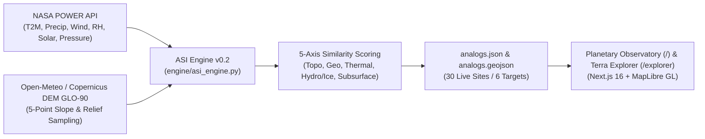

<p align="center">
  
</p>

<h1 align="center">ATLANIA // Planetary Observatory &amp; Earth-Space Analog Atlas</h1>

<p align="center">
  <strong>NASA International Space Apps Challenge 2026</strong><br />
  Desafío: <em>Identify Earth Locations that Analog the Permanent Moon Base Locations and Mars</em>
</p>

<blockquote align="center">
  <em>
    &ldquo;Existe una belleza particular en los lugares que no podemos encontrar.<br />
    Hace siglos, los cartógrafos dibujaban territorios que todavía no habían explorado. Hoy levantamos la mirada al cielo y reconocemos cráteres, cañones y llanuras que parecen pertenecer a mundos completamente distintos.<br /><br />
    <strong>¿Y si para comprender otros planetas primero tuviéramos que volver a descubrir el nuestro?</strong><br /><br />
    ATLANIA nace de esa pregunta. No busca inventar territorios perdidos; busca revelar lo extraordinario que ya existe en la Tierra para abrir una ventana hacia la Luna y Marte.<br />
    Porque quizá lo desconocido siempre estuvo aquí, esperando a que volviéramos a mirar.&rdquo;
  </em>
</blockquote>

<p align="center">
  <a href="https://github.com/FakeCxbas/Atlania/actions/workflows/ci.yml">
    
  </a>
  
  
  
  
  
</p>

---

## System Architecture



## Extraterrestrial Reference Targets

| Target ID | Reference Site | Body | Primary Mission Context |
| :--- | :--- | :--- | :--- |
| `shackleton-crater` | Shackleton Crater / Lunar South Pole | Moon | Artemis polar cold-trap & volatile ice prospecting |
| `mare-tranquillitatis` | Mare Tranquillitatis Pits | Moon | Subsurface basaltic lava tube thermal shielding |
| `mouton-mons` | Mons Mouton / Lunar South Pole Plateau | Moon | Artemis III high-illumination plateau & polar regolith |
| `jezero-crater` | Jezero Crater | Mars | Fluvio-lacustrine delta, clays, carbonates & basalt |
| `olympus-mons-flank` | Olympus Mons Flank | Mars | High-elevation volcanic shield & lava tube operations |
| `valles-marineris` | Valles Marineris | Mars | Deep tectonic canyon stratigraphy, sulfates & talus slopes |

## Scientific Evaluation Methodology (ASI)

El **Índice de Similitud Análoga (ASI)** desarrollado para ATLANIA calcula una correlación cuantitativa multidimensional ($0.00$ a $1.00$) normalizada a través de 5 vectores clave:
1. **Topografía & Relieve:** Pendiente media y rugosidad local calculada con muestreo en 5 puntos sobre el modelo de elevación global Copernicus DEM GLO-90.
2. **Geología & Mineralogía:** Sustrato basáltico, regolito fino, arcillas filizadas, sulfatos y análogos de impacto.
3. **Condiciones Térmicas Extremas:** Amplitud térmica diurna, medias extremas y radiación solar superficial incidente (NASA POWER API).
4. **Hidrología & Aridez / Hielo:** Tasa de precipitación anual, humedad relativa y persistencia de permafrost / campos glaciares.
5. **Entorno Subterráneo:** Presencia de tubos de lava basáltica como refugio térmico y blindaje contra radiación ionizante para hábitats Artemis.

### Análogos Regionales Clave de Sudamérica

- **Galápagos Lava Tubes (Ecuador):** Tubos de lava basáltica prístinos con estabilidad térmica constante ($\sim 22^\circ\text{C}$), análogo de primer orden para bases subterráneas en *Mare Tranquillitatis*.
- **Chimborazo High-Altitude Paramó (Ecuador):** Terreno volcánico peri-glaciar sobre los 4.800 msnm con baja presión atmosférica, alta radiación UV y regolito andesítico.
- **Desierto de Atacama / Yungay (Chile):** El límite seco de la Tierra para pruebas de instrumentación hiper-árida marciana (*Jezero Crater*).

---

## Quickstart

### 1. Frontend (Next.js 16 + MapLibre GL)
```bash
cd frontend
npm install
npm run dev
```
- `http://localhost:3000/` — **ATLANIA — Observatorio Planetario & Briefing** (presentación científica interactiva, paneles comparativos Tierra vs. Luna/Marte, desglose ASI en vivo y catálogo de destinos planetarios).
- `http://localhost:3000/explorer` — **ATLANIA — Terra Explorer & Satellite Observatory** (mapa de terreno 3D interactivo, sondeo de coordenadas en vivo `/api/evaluate`, prospección regional en grilla `/api/evaluate-region`, perfil satelital de 3 sensores y exportación Markdown/JSON/GeoJSON). Admite enlaces directos mediante `?target=<id>` y `?site=<id>`.

### 2. Scientific ASI Engine (Python / uv)
```bash
cd engine
uv sync
.venv/bin/python -m pytest tests
.venv/bin/python build_dataset.py --timeout 10
```

---

## Active Frontend Issues & Progress

| Issue | Scope | Status |
| :--- | :--- | :--- |
| [#2](https://github.com/FakeCxbas/nasa-space-apps-2026/issues/2) | `feat(ui)`: Side-by-side Earth vs Moon/Mars target comparison view | Open |
| [#3](https://github.com/FakeCxbas/nasa-space-apps-2026/issues/3) | `feat(map)`: 3D terrain tilt, site telemetry popups & NASA GIBS controls | Open |
| [#4](https://github.com/FakeCxbas/nasa-space-apps-2026/issues/4) | `feat(ux)`: ASI dossier export, methodology dialog & mobile HUD | Closed ([PR #8](https://github.com/FakeCxbas/nasa-space-apps-2026/pull/8)) |
| [#6](https://github.com/FakeCxbas/nasa-space-apps-2026/issues/6) | `feat(engine)`: Copernicus DEM sampling, NASA POWER v0.2 & 16 sites | Closed ([PR #7](https://github.com/FakeCxbas/nasa-space-apps-2026/pull/7)) |

---

## Team Git Workflow

1. Never push directly to the default branch. Create a dedicated branch:
   ```bash
   git checkout -b feat/issue-2-target-comparison
   ```
2. Use Conventional Commits (`feat(...)`, `fix(...)`, `docs(...)`, `test(...)`) and link the issue:
   ```bash
   git commit -m "feat(ui): add side-by-side target comparison view (closes #2)"
   ```
3. Push and open a Pull Request:
   ```bash
   git push -u origin feat/issue-2-target-comparison
   gh pr create --fill
   ```
